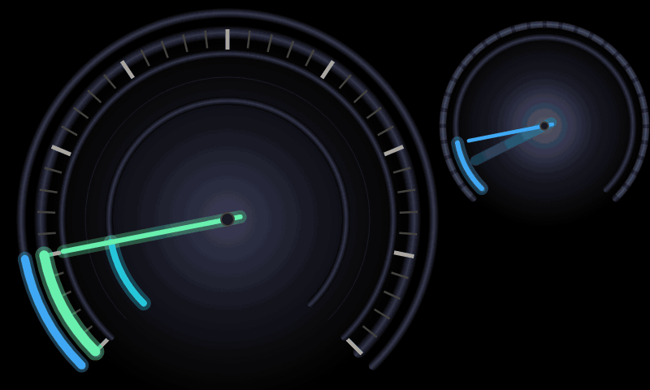

# pi-obd-meter

<p align="center">
  
</p>

**車のコンピューターが流しているデータを読んで、速度・エンジン回転・ギア・燃費をその場で表示する自作のデジタルメーター。**
Raspberry Pi と 5 インチの画面で動き、走った記録を自動で残す。

上の動画は、実際の走行ログ（止まった状態から 110km/h までの全開加速）をメーターに 2 倍速で流し直したもの。
針・数字・ギアの動きはログのとおりで、右下の平均燃費・給油までの距離・オイルの 3 つだけ固定の値にしている。

## 何ができる？

**走りながら見られるもの**

- 速度、エンジンの回転、アクセルの踏み込み
- 今入っているギアと、AT の状態（ギアを固定しているか、エンジンとタイヤが直結しているか）
- 今の燃費（色でひと目で分かる）と、エンジンが空気を吸い込む強さ
- 給油してからの平均燃費、あと何 km 走れるか、給油してから何 km 走ったか、オイル交換まであと何 km か

**勝手にやってくれること**

- 給油したことに自分で気づいて、距離と燃費を数え直す
- 走った記録・給油・整備の状態を Google スプレッドシートに送る（スマホで見られる）
- エンジンをかけるたびに新しい版があるか確かめて、自分で更新する
- 走りのデータ（車の通信・位置・坂）を記録して、あとで分析できるようにする
- エンジンを切ると画面が暗くなり、かけると起動のアニメーションから戻る
- 電源をいきなり切られても壊れにくい（車ではキーを抜くと電源も一緒に落ちるため）

## 画面の見方

<p align="center">
  
</p>

| | 表示 | 意味 |
|---|---|---|
| 1 | 速度 | km/h。真ん中の大きい数字 |
| 2 | 速度の帯 | いちばん外側。速いほど伸び、色も変わる（街中は水色、100km/h を超えると黄色、130km/h から赤） |
| 3 | エンジンの回転 | 数字と針。目盛りは 1,000 回転ごと。6,000 回転で赤になる（変速の目安）。左右の ▼▲ は回転が下がっている／上がっている印 |
| 4 | アクセル | 内側の短い帯。踏むほど伸びる |
| 5 | レンジ | P・R・N・D・S・L。HOLD はギアを固定しているとき |
| 6 | ギア | 今入っている段（1〜4）。変速の途中は点滅する。LOCK はエンジンとタイヤが直結していて、滑りが無く燃費が良い状態 |
| 7 | 今の燃費 | 中の数字が km/L（止まっているときは 1 時間に使う燃料 L/h）。外側の点の数と色が燃料の使い方で、多く赤いほど使っている。アクセルを離すと燃料が止まり、水色になる |
| 8 | 吸い込む強さ | 針・内側の帯・下の数字。アクセルを離すほど強く吸い（−1 に近づく）、踏むほど 0 に近づく |
| 9 | 平均燃費 | 給油してからの平均（km/L） |
| 10 | 給油までの距離 | 燃料の残りと平均燃費から、あと何 km 走れるか |
| 11 | トリップ | 給油してから走った距離。400km で黄、450km で橙、500km で赤 |
| 12 | オイル | オイル交換まであと何 km か |

詳しい決まり（色の境目、数字を書き換える間隔など）は [docs/meter-indicators.md](docs/meter-indicators.md)。

## どう動いているか

<p align="center">
  
</p>

車の中では、エンジンや AT のコンピューターが CAN という通信線でデータをやりとりしている。運転席の足元にある
OBD 端子からそれを読み取り、Raspberry Pi が計算して画面に出す。**読むだけで、車には何も書き込まない。**
記録は車の WiFi ルーターを通して Google スプレッドシートへ送り、新しい版はエンジンをかけたときに GitHub から取ってくる。

## この車でわかったこと

記録したデータを分析して分かったことの例。

| 何を | 結果 | 詳しく |
|---|---|---|
| 燃費の表示の正確さ | 1 タンク（384km）でレシートとの差 −1.5% | [calculation-logic.md](docs/calculation-logic.md) |
| 距離の正確さ | GPS との差 +0.4% | [vehicle-baseline.md](docs/vehicle-baseline.md) |
| 加速 | 0→100km/h は平らな道で約 15 秒 | [vehicle-baseline.md](docs/vehicle-baseline.md) |
| エンジンの力 | 最大トルク約 120 N·m・最大馬力約 85PS（カタログの 97%・93%） | [vehicle-baseline.md](docs/vehicle-baseline.md) |
| 高速の燃費 | 105km/h で 12.8km/L、132km/h で 9.6km/L | [vehicle-baseline.md](docs/vehicle-baseline.md) |
| AT の変速 | S レンジで床まで踏むと 5,820 回転で勝手に上がる。手で上げるなら 6,000 回転でレバー | [at-shift-points.md](docs/at-shift-points.md) |
| 給油の検出 | 燃料計の跳ね上がりで給油に気づく | [refuel-detection.md](docs/refuel-detection.md) |

## 対応している車

今は **マツダ DY デミオ（DBA-DY3W、1.3L・4AT）** で動かしている。CAN のどこに何が入っているかは車種ごとに違うので、
ほかの車ではそのままでは動かない。

## 使っている部品

| 役割 | 部品 |
|---|---|
| 本体 | Raspberry Pi 4 Model B（2GB） |
| 車とつなぐ | CAN HAT（Waveshare RS485 CAN HAT、MCP2515）と OBD-II ケーブル |
| 画面 | ELECROW 5 インチ IPS（800×480、HDMI） |
| 位置・高さ | USB の GPS（u-blox 7） |
| 坂・横 G | 傾きセンサー GY-521（MPU-6050） |
| 記録 | USB の SSD（走行データ）、microSD（起動用） |
| ケース | GeeekPi アルミケース（ファン 2 つ。夏のダッシュボードの上では 80℃ を超えるため） |
| 電源 | シガーソケットの USB-C（5V/3A） |

## 動かしてみる

Mac で、車につながずにデモを見られる。

```bash
cp configs/config.mac.json.example configs/config.mac.json
go run ./cmd/pi-obd-meter -demo -config configs/config.mac.json
open -a Safari http://localhost:9090/meter.html   # 車の画面と同じ WebKit で表示される
```

車に載せる手順は [docs/setup-guide.md](docs/setup-guide.md)、設定の一覧は [docs/configuration.md](docs/configuration.md)。

## 開発者向け

- 開発の流れ・CI/CD・リリース・自動更新: [docs/development.md](docs/development.md)
- コードの構成と設計の決まり事: [CLAUDE.md](CLAUDE.md)

**docs の一覧**

| 分類 | ドキュメント |
|---|---|
| 使い方・設定 | [setup-guide](docs/setup-guide.md)（セットアップ）・[configuration](docs/configuration.md)（設定）・[development](docs/development.md)（開発）・[wifi-troubleshooting](docs/wifi-troubleshooting.md)（WiFi の不具合）・[rtc-ds3231](docs/rtc-ds3231.md)（時計の追加） |
| 表示と計算 | [meter-indicators](docs/meter-indicators.md)（表示の意味）・[calculation-logic](docs/calculation-logic.md)（燃費などの計算）・[refuel-detection](docs/refuel-detection.md)（給油の検出）・[data-logging](docs/data-logging.md)（データの記録） |
| この車の実測 | [vehicle-baseline](docs/vehicle-baseline.md)（正常値・加速・力）・[at-shift-points](docs/at-shift-points.md)（AT の変速）・[atf-thermal](docs/atf-thermal.md)（AT の油温）・[map-vs-load](docs/map-vs-load.md)（吸気とアクセル）・[imu](docs/imu.md)（傾きセンサー）・[can-pid-map](docs/can-pid-map.md)（CAN の中身）・[can-gear-ratio-analysis](docs/can-gear-ratio-analysis.md)（ギア比） |
| 試験・運用の記録 | [drive-test-plan](docs/drive-test-plan.md)・[can-capture-test](docs/can-capture-test.md)・[boot-resilience](docs/boot-resilience.md)（電源断への備え）・[incident-2026-09-07](docs/incident-2026-09-07.md)（障害記録）・[upstream-report-status16](docs/upstream-report-status16.md)（WiFi の不具合の報告文） |

## ⚠ 注意

- 本ソフトウェアは MIT License のもと「無保証 (AS IS)」で提供されます。使用により生じた車両故障・事故・データ消失等について、作者はいかなる責任も負いません
- OBD-2 ポート / CAN バスへの接続および本ソフトウェアの導入は、**すべて利用者の自己責任**で行ってください
- 本ソフトウェアは ECU/ATCU への**書き込み系コマンド (Mode 04 / 08 / 27 / 2E 等) を一切実装していません**。受動受信および読み出し (Mode 01 / 03 / 22) のみ
- 受動受信であっても CAN HAT 経由で誤った接続をするとバス通信に影響を与え得るため、**OBD-2 ピン配列・電気仕様を理解した上で接続**してください
- 動作確認は **マツダ DY デミオ (DBA-DY3W, ZJ-VE 1.3L, 4AT)** のみ。他車種では CAN フレーム ID / バイト位置・スケーリングが異なるため、想定外の表示・動作が起こり得ます
- 公道走行中の操作は最低限に。**画面の凝視および長押し操作 (キオスク終了) は安全な停車中**に行ってください

## ライセンス

MIT
