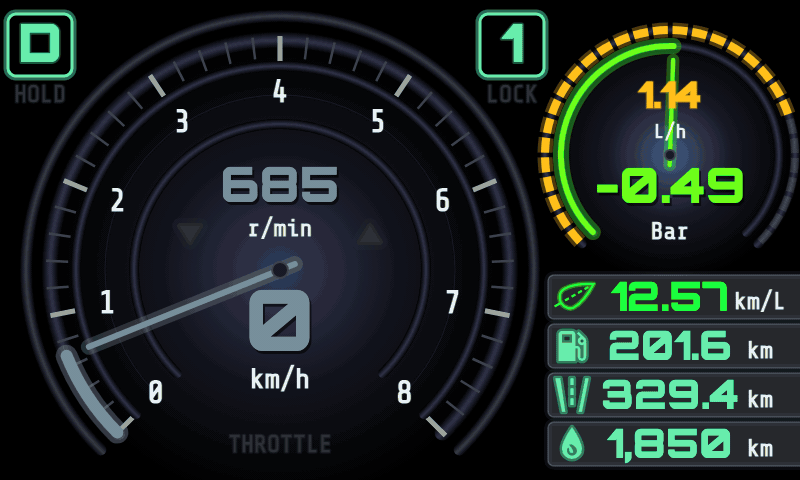
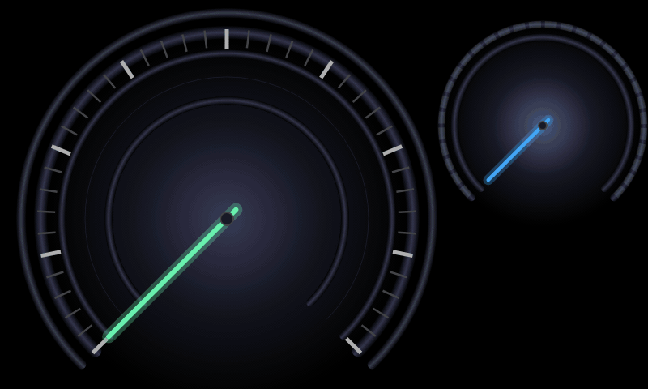
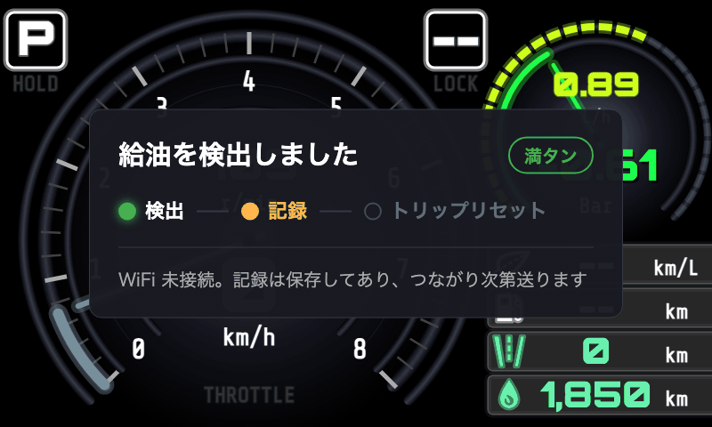
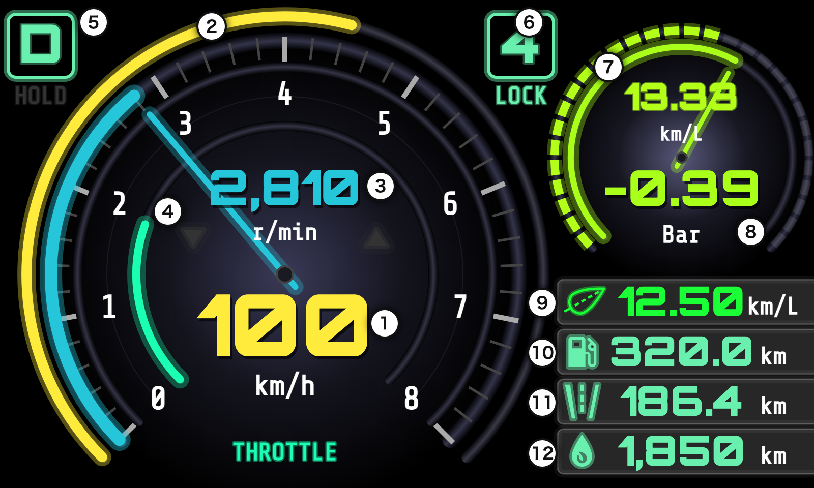
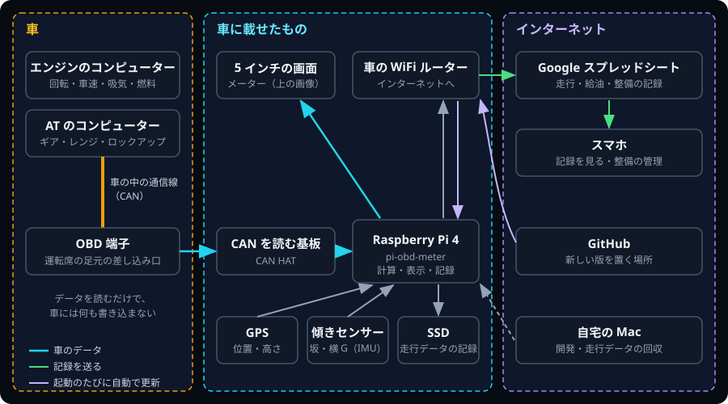

# pi-obd-meter

<p align="center">
  
</p>

**ECU・ATCU が CAN バスに流しているデータを OBD-II ポートから読み、車速・回転数・ギア・燃費をリアルタイムに表示する自作のデジタルメーター。**
Raspberry Pi 4 と 5 インチ液晶で動き、走行ログを自動で残す。

上の GIF は、実際の走行ログ（街乗りの発進から停止まで 35 秒）を等速でメーターに流し直したもの。
ログは 0.2 秒ごとなので、実車と同じ 50ms ごとになるよう行の間を補間している。
航続可能距離はログの燃料計から計算し直した値で、オイル交換までの距離だけ固定値。

## できること

**走行中に見られるもの**

- 車速・回転数・スロットル開度
- 実ギア（変速中は点滅）・レンジ・HOLD・トルコンのロックアップ
- 瞬間燃費（停車中は L/h）とバキューム（インマニ負圧）
- 給油からの平均燃費・航続可能距離・トリップ・オイル交換までの距離

**自動でやること**

- 燃料計の跳ね上がりから給油を検出し、トリップと平均燃費をリセット
- 走行・給油・整備の記録を Google スプレッドシートへ送信（スマホで見られる）
- 起動のたびに GitHub の新しいリリースを確かめて OTA 更新
- CAN・GPS・IMU のログを SSD に記録
- エンジン停止（CAN が止まる）で画面を暗くし、始動すると起動アニメーションから復帰
- キーオフで電源ごと落ちても壊れにくい（ルートは overlayfs で読み取り専用）

## 起動と給油

<p align="center">
  
  
</p>

- **起動**: 針を 0 → 最大 → 0 とスイープしてから表示を出す（約 2.8 秒）
- **給油**: 満タン給油後の始動時の流れを、実際の給油（10/12）の時刻どおりに再現したもの。
  検出 → 記録 → トリップリセットの進み具合を停車中だけ出す。この日は WiFi の接続を待ってから
  GAS に記録し、前のタンク（422.2km・12.5km/L）を表示した

## 画面の見方

<p align="center">
  
</p>

| | 表示 | 意味 |
|---|---|---|
| 1 | 車速 | km/h。中央の大きい数字 |
| 2 | 車速バー | 最外周。速いほど伸び、色も変わる（10km/h から青、30 水色、60 緑、80 黄緑、100 黄、120 橙、130 赤） |
| 3 | タコメーター | 回転数と針。目盛りは 1,000rpm ごと、6,000rpm から赤（シフトアップの目安）。左右の ▼▲ は回転の下降・上昇 |
| 4 | スロットル | 内側の短いバー。踏むほど伸びる |
| 5 | レンジ | P・R・N・D・S・L。HOLD は HOLD スイッチでギアを固定しているとき |
| 6 | ギア | 実ギア（1〜4、ギア比から判定）。変速中は次の段を点滅。LOCK はトルコンのロックアップ |
| 7 | 瞬間燃費 | 中の数字が km/L（停車中は L/h）。外周のセグメントは燃料消費の多さで、多いほど赤い。燃料カット中は水色 |
| 8 | バキューム | 針・内側のバー・下の数字（Bar）。インマニ負圧で、アクセルを戻すほど −1 に近づく |
| 9 | 平均燃費 | 給油からの平均（km/L） |
| 10 | 航続可能距離 | 推定残量 × 平均燃費 |
| 11 | トリップ | 給油からの距離。400km で黄、450km で橙、500km で赤 |
| 12 | オイル | オイル交換までの残距離 |

詳しい決まり（色の境目、数字を書き換える間隔など）は [docs/meter-indicators.md](docs/meter-indicators.md)。

## しくみ

<p align="center">
  
</p>

ECU と ATCU は CAN バスでデータをやりとりしている。OBD-II ポートから CAN HAT（MCP2515）でそれを受信し、
Raspberry Pi が計算して液晶に出す。**受信と読み出しだけで、ECU には何も書き込まない。**
記録は車載 WiFi ルーター経由で Google スプレッドシート（GAS）へ送り、新しいリリースは起動時に GitHub から取ってくる。

## この車でわかったこと

ログを分析して分かったことの例。

| 項目 | 結果 | 詳しく |
|---|---|---|
| 燃費表示の精度 | 1 タンク（384km）でレシートとの差 −1.5% | [calculation-logic.md](docs/calculation-logic.md) |
| 距離の精度 | GPS との差 +0.4% | [vehicle-baseline.md](docs/vehicle-baseline.md) |
| 加速 | 0→100km/h 約 15 秒（平坦路） | [vehicle-baseline.md](docs/vehicle-baseline.md) |
| トルク・出力 | 最大トルク約 120 N·m・最高出力約 85PS（カタログ値の 97%・93%） | [vehicle-baseline.md](docs/vehicle-baseline.md) |
| 高速燃費 | 105km/h で 12.8km/L、132km/h で 9.6km/L | [vehicle-baseline.md](docs/vehicle-baseline.md) |
| AT の変速点 | S レンジ・WOT では 5,820rpm で自動シフトアップ。手動なら 6,000rpm でシフト | [at-shift-points.md](docs/at-shift-points.md) |
| 給油検出 | 燃料計の跳ね上がりで検出 | [refuel-detection.md](docs/refuel-detection.md) |

## 対応車種

**マツダ DY デミオ（DBA-DY3W、ZJ-VE 1.3L・4AT）** で動作確認。CAN ID・バイト位置・スケーリングは車種ごとに違うので、
他車種ではそのままでは動かない。

## 使用部品

| 役割 | 部品 |
|---|---|
| 本体 | Raspberry Pi 4 Model B（2GB） |
| CAN | Waveshare RS485 CAN HAT（MCP2515）と OBD-II ケーブル |
| 液晶 | ELECROW 5 インチ IPS（800×480、HDMI） |
| GPS | u-blox 7（USB） |
| IMU | GY-521（MPU-6050） |
| ストレージ | USB SSD（ログ）、microSD（起動用） |
| ケース | GeeekPi アルミケース（ファン 2 つ。夏のダッシュボードの上では 80℃ を超えるため） |
| 電源 | シガーソケットの USB-C（5V/3A） |

## 動かしてみる

Mac で、車につながずにデモを見られる。

```bash
cp configs/config.mac.json.example configs/config.mac.json
go run ./cmd/pi-obd-meter -demo -config configs/config.mac.json
open -a Safari http://localhost:9090/meter.html   # 車の画面と同じ WebKit で表示される
```

車に載せる手順は [docs/setup-guide.md](docs/setup-guide.md)、設定の一覧は [docs/configuration.md](docs/configuration.md)。

## 開発者向け

- 開発の流れ・CI/CD・リリース・自動更新: [docs/development.md](docs/development.md)
- コードの構成と設計の決まり事: [CLAUDE.md](CLAUDE.md)

**docs の一覧**

| 分類 | ドキュメント |
|---|---|
| 使い方・設定 | [setup-guide](docs/setup-guide.md)（セットアップ）・[configuration](docs/configuration.md)（設定）・[development](docs/development.md)（開発）・[wifi-troubleshooting](docs/wifi-troubleshooting.md)（WiFi の不具合）・[rtc-ds3231](docs/rtc-ds3231.md)（RTC の追加） |
| 表示と計算 | [meter-indicators](docs/meter-indicators.md)（表示の意味）・[calculation-logic](docs/calculation-logic.md)（燃費などの計算）・[refuel-detection](docs/refuel-detection.md)（給油の検出）・[data-logging](docs/data-logging.md)（データの記録） |
| この車の実測 | [vehicle-baseline](docs/vehicle-baseline.md)（正常値・加速・トルク）・[at-shift-points](docs/at-shift-points.md)（AT の変速点）・[atf-thermal](docs/atf-thermal.md)（ATF 温度）・[map-vs-load](docs/map-vs-load.md)（MAP と負荷）・[imu](docs/imu.md)（IMU）・[can-pid-map](docs/can-pid-map.md)（CAN ID・PID の対応）・[can-gear-ratio-analysis](docs/can-gear-ratio-analysis.md)（ギア比） |
| 試験・運用の記録 | [drive-test-plan](docs/drive-test-plan.md)・[can-capture-test](docs/can-capture-test.md)・[boot-resilience](docs/boot-resilience.md)（電源断への備え）・[incident-2026-09-07](docs/incident-2026-09-07.md)（障害記録）・[upstream-report-status16](docs/upstream-report-status16.md)（WiFi の不具合の報告文） |

## ⚠ 注意

- 本ソフトウェアは MIT License のもと「無保証 (AS IS)」で提供されます。使用により生じた車両故障・事故・データ消失等について、作者はいかなる責任も負いません
- OBD-2 ポート / CAN バスへの接続および本ソフトウェアの導入は、**すべて利用者の自己責任**で行ってください
- 本ソフトウェアは ECU/ATCU への**書き込み系コマンド (Mode 04 / 08 / 27 / 2E 等) を一切実装していません**。受動受信および読み出し (Mode 01 / 03 / 22) のみ
- 受動受信であっても CAN HAT 経由で誤った接続をするとバス通信に影響を与え得るため、**OBD-2 ピン配列・電気仕様を理解した上で接続**してください
- 動作確認は **マツダ DY デミオ (DBA-DY3W, ZJ-VE 1.3L, 4AT)** のみ。他車種では CAN フレーム ID / バイト位置・スケーリングが異なるため、想定外の表示・動作が起こり得ます
- 公道走行中の操作は最低限に。**画面の凝視および長押し操作 (キオスク終了) は安全な停車中**に行ってください

## ライセンス

MIT
